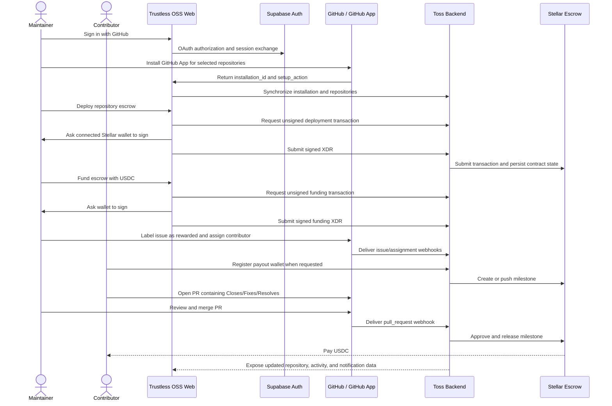
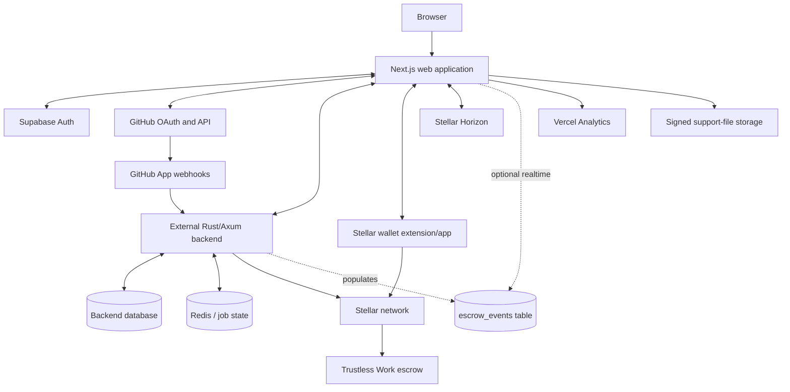
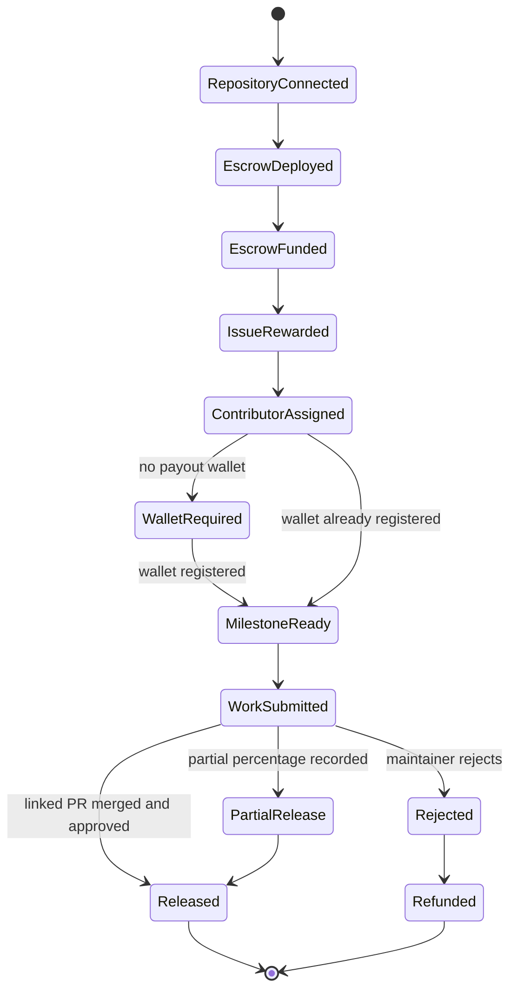

# Trustless OSS — Complete Project Guide

> An end-to-end technical and product guide to the Trustless OSS web application.
>
> **Repository scope:** this repository contains the standalone Next.js frontend and its small
> server-side route handlers. The Rust/Axum backend, GitHub webhook workers, database, and escrow
> orchestration service are deployed separately.
>
> **Reviewed:** 2026-11-02 against the source code in this repository.

## Table of contents

1. [Executive summary](#1-executive-summary)
2. [The problem this project solves](#2-the-problem-this-project-solves)
3. [Who uses it](#3-who-uses-it)
4. [Core concepts and terminology](#4-core-concepts-and-terminology)
5. [How the product works from start to finish](#5-how-the-product-works-from-start-to-finish)
6. [System architecture](#6-system-architecture)
7. [What is inside this repository](#7-what-is-inside-this-repository)
8. [Application routes and screens](#8-application-routes-and-screens)
9. [Authentication and authorization](#9-authentication-and-authorization)
10. [GitHub integration](#10-github-integration)
11. [Bounty lifecycle](#11-bounty-lifecycle)
12. [Stellar wallets, USDC, and escrow](#12-stellar-wallets-usdc-and-escrow)
13. [Dashboard, analytics, and notifications](#13-dashboard-analytics-and-notifications)
14. [Backend integration and API map](#14-backend-integration-and-api-map)
15. [Data shapes and state](#15-data-shapes-and-state)
16. [Network selection](#16-network-selection)
17. [Support and waitlist flows](#17-support-and-waitlist-flows)
18. [Design system and user experience](#18-design-system-and-user-experience)
19. [SEO, crawling, and public discovery](#19-seo-crawling-and-public-discovery)
20. [Security model](#20-security-model)
21. [Error handling and resilience](#21-error-handling-and-resilience)
22. [Testing and quality controls](#22-testing-and-quality-controls)
23. [Local development](#23-local-development)
24. [Environment variables](#24-environment-variables)
25. [Build and deployment](#25-build-and-deployment)
26. [Current implementation status and limitations](#26-current-implementation-status-and-limitations)
27. [Repository directory map](#27-repository-directory-map)
28. [Common maintenance tasks](#28-common-maintenance-tasks)
29. [Troubleshooting](#29-troubleshooting)
30. [Recommended next steps](#30-recommended-next-steps)

---

## 1. Executive summary

Trustless OSS connects a normal GitHub contribution workflow to programmable, on-chain bounty
payments. A maintainer connects a GitHub repository, deploys and funds a Stellar USDC escrow,
marks issues as rewarded, and assigns contributors. When a contributor completes the work and a
properly linked pull request is merged, the backend can approve and release the corresponding
escrow milestone.

The product is designed to make three things visible and verifiable:

- the reward promised for an issue;
- the funds available or reserved in escrow;
- the event that makes a contributor eligible for payment.

The web application is not the whole system. It is the user-facing control plane. It relies on:

- **Supabase** for GitHub OAuth sessions and optional realtime event delivery;
- a **GitHub App** for repository access and contribution events;
- a separately deployed **Toss Backend** for persistence, authorization, webhook processing, and
  transaction orchestration;
- **Stellar wallets**, **Stellar Horizon**, and **Trustless Work escrow contracts** for USDC
  funding and settlement;
- optionally, **Circle CCTP** for future cross-chain payout routing.

The current repository uses Next.js 16.4.1, React 19.2.4, TypeScript 5, Tailwind CSS 4, pnpm 11,
Vitest, Testing Library, Supabase SSR, Stellar Wallets Kit, Stellar SDK, Recharts, and Vercel
Analytics.

## 2. The problem this project solves

Open-source rewards are often managed with spreadsheets, private messages, manual wallet
transfers, and unclear approval rules. That creates several problems:

- contributors may not know whether reward funds actually exist;
- maintainers must manually track assignments, PRs, and payment status;
- payout decisions and partial-payment decisions can be difficult to audit;
- wallet collection can expose sensitive information in ad hoc channels;
- a repository's financial activity is disconnected from its code-review history.

Trustless OSS reduces this coordination burden by using GitHub events as workflow signals and an
escrow contract as the source of payment state. GitHub remains the place where work is discussed,
assigned, reviewed, and merged; Trustless OSS adds the reward and settlement layer.

## 3. Who uses it

### Maintainers

Maintainers authenticate with GitHub, install the Trustless OSS GitHub App, synchronize selected
repositories, configure reward tiers, deploy and fund escrow contracts, inspect bounty issues,
retry failed processing, refund eligible funds, and review activity.

### Contributors

Contributors are assigned to rewarded issues, register or update a Stellar payout wallet, complete
the work, and link their pull request to the issue. Their profile can contain a Stellar address,
basic public information, skills, social links, and a preferred future payout network.

### Public visitors

Visitors can read the landing page, see the product workflow, view the public contributor
leaderboard, inspect the public event presentation, open documentation, join the waitlist, and
contact support.

### Operators and backend maintainers

Operators configure Supabase, the GitHub App, backend URLs, network-specific infrastructure,
storage uploads, analytics, and deployment. Backend maintainers implement and maintain the REST
contracts summarized in this guide and specified in greater detail in
[`BACKEND_API_REQUIREMENTS.md`](./BACKEND_API_REQUIREMENTS.md).

## 4. Core concepts and terminology

| Term            | Meaning in this project                                                                 |
| --------------- | --------------------------------------------------------------------------------------- |
| Repository      | A GitHub repository connected through a GitHub App installation.                        |
| Rewarded issue  | A GitHub issue carrying `rewarded` plus a reward-level label.                           |
| Reward tier     | A repository-specific label and USDC amount, such as low, medium, or high.              |
| Custom reward   | A reward amount provided through a bot comment after applying `custom`.                 |
| Assignment      | The relationship between a rewarded issue and its contributor.                          |
| Escrow          | A Trustless Work contract holding and releasing repository USDC funds.                  |
| Pool balance    | USDC available in the repository escrow.                                                |
| Milestone       | An escrow allocation corresponding to a bounty or a stage of work.                      |
| Release         | Payment from an approved milestone to a contributor.                                    |
| Refund          | Return of eligible escrow funds to the recorded funder wallet.                          |
| Linked PR       | A pull request whose body uses a supported closing keyword for the bounty issue.        |
| Testnet/mainnet | Separate Stellar networks with separate backend and GitHub App configuration.           |
| CCTP            | Circle's cross-chain transfer protocol, represented in the UI as a future payout route. |

## 5. How the product works from start to finish



### The happy path

1. The maintainer signs in through Supabase GitHub OAuth.
2. The maintainer installs the configured GitHub App and chooses repositories.
3. The app receives GitHub's setup callback and asks the backend to sync the installation.
4. A repository appears in the dashboard.
5. The maintainer opens it and deploys a Trustless Work escrow contract.
6. The maintainer funds the escrow with Stellar USDC by signing a wallet transaction.
7. The maintainer configures reward labels and amounts.
8. A GitHub issue receives `rewarded` and one reward label.
9. A contributor is assigned and registers a payout address.
10. The backend creates the corresponding milestone when prerequisites are met.
11. The contributor opens a PR whose body contains `Closes #123`, `Fixes #123`, or
    `Resolves #123`.
12. When the PR is merged, the backend interprets the GitHub event and releases the eligible
    payout.
13. Repository balances, issue state, activity, leaderboard data, and notifications update through
    backend API responses.

### Partial payment and rejection

Maintainers can use GitHub issue comments to record a partial completion percentage or reject the
work. The backend owns the authorization and resulting payout/dispute behavior. Examples:

```text
@Trustless-OSS /pay 75
@Trustless-OSS /reject
@Trustless-OSS /retry
```

The complete command set is documented in [`BOT_COMMANDS.md`](./BOT_COMMANDS.md).

## 6. System architecture



### Responsibility boundaries

| Layer                  | Responsibilities                                                                                                                                                                       |
| ---------------------- | -------------------------------------------------------------------------------------------------------------------------------------------------------------------------------------- |
| Browser UI             | Navigation, forms, charts, wallet prompts, validation, local filtering, feedback.                                                                                                      |
| Next.js server         | Server rendering, auth callback/sign-out, session refresh, backend proxy, waitlist endpoint.                                                                                           |
| Supabase               | GitHub OAuth session and optional realtime event subscription.                                                                                                                         |
| GitHub App             | Installation scope and repository lifecycle webhooks.                                                                                                                                  |
| Toss Backend           | Domain authorization, persistence, GitHub webhook interpretation, API contracts, unsigned transaction construction, signed transaction submission, milestone and payout orchestration. |
| Wallet                 | User authorization and signing; private keys stay in the user's wallet.                                                                                                                |
| Stellar/Trustless Work | On-chain contract deployment, escrow state, funding, release, and refund settlement.                                                                                                   |

The frontend must never be treated as the authority for balances, ownership, or payout eligibility.
Those rules belong in the backend and on-chain contract.

## 7. What is inside this repository

This repository contains:

- Next.js App Router pages and layouts;
- client and server React components;
- a Supabase OAuth callback and sign-out handler;
- a same-origin proxy for the external backend;
- a validated waitlist route with optional Google Sheets persistence;
- GitHub installation synchronization UI;
- Stellar wallet discovery, transaction signing, trustline helpers, and explorer links;
- repository, bounty, reward, escrow, profile, support, analytics, and notification UI;
- mock or Supabase-backed homepage escrow events;
- shared data normalization and filtering utilities;
- unit and component tests;
- SEO routes, static crawler files, and deployment configuration.

It does **not** contain:

- the Rust/Axum Toss Backend source;
- GitHub webhook handlers;
- backend database migrations;
- Redis/job infrastructure;
- Trustless Work contract source;
- server-side transaction-signing secrets;
- a production `escrow_events` provisioning script;
- the implementation of CCTP cross-chain settlement.

## 8. Application routes and screens

### Public and authentication routes

| Route                 | Purpose                                                                                       | Data source                                                            |
| --------------------- | --------------------------------------------------------------------------------------------- | ---------------------------------------------------------------------- |
| `/`                   | Landing page, workflow, public leaderboard preview, event feed, future payout routes.         | Supabase session, public backend leaderboard, mock or Supabase events. |
| `/login`              | GitHub OAuth sign-in.                                                                         | Supabase browser client.                                               |
| `/auth/callback`      | Exchanges OAuth code for a Supabase session and stores the GitHub provider token temporarily. | Supabase server client.                                                |
| `/auth/signout`       | Ends the Supabase session and clears application cookies.                                     | Supabase server client.                                                |
| `/leaderboard/[page]` | Paginated, searchable, sortable public contributor leaderboard.                               | Public backend `/api/leaderboard`.                                     |
| `/support`            | Support-ticket form and optional direct attachment upload.                                    | Backend upload and ticket endpoints.                                   |
| `/robots.txt`         | Dynamic crawler policy generated by `app/robots.ts`.                                          | Static configuration.                                                  |
| `/sitemap.xml`        | Dynamic public URL list generated by `app/sitemap.ts`.                                        | Static configuration.                                                  |
| `/docs`               | Permanent redirect to the external documentation site.                                        | `next.config.ts`.                                                      |

### Protected maintainer routes

| Route                        | Purpose                                                                                                                                |
| ---------------------------- | -------------------------------------------------------------------------------------------------------------------------------------- |
| `/dashboard`                 | Overview metrics, funds movement, repository charts, and navigation shortcuts.                                                         |
| `/dashboard/repos`           | Connected repositories with search, filters, sorting, pagination, sync, and bounty counts.                                             |
| `/dashboard/repos/new`       | Starts GitHub App installation in the same tab.                                                                                        |
| `/dashboard/repos/[repoId]`  | Repository escrow state, balance, reward configuration, bounty issues, retry controls, fund/refund/deploy actions, and external links. |
| `/dashboard/settings/github` | Handles GitHub App setup results and installation synchronization.                                                                     |
| `/dashboard/github-setup`    | Compatibility redirect to the settings callback route.                                                                                 |
| `/dashboard/transactions`    | Activity/transaction ledger with filters and explorer/GitHub links.                                                                    |
| `/profile`                   | Contributor profile, Stellar address, trustline state, skills, social links, and payout preferences.                                   |

The session middleware protects all paths beginning with `/dashboard`. The profile route performs
its own server-side user check and redirects to `/login?next=/profile` when needed.

## 9. Authentication and authorization

### Sign-in flow

1. `/login` calls `supabase.auth.signInWithOAuth({ provider: "github" })`.
2. Requested OAuth scopes are `read:user user:email`.
3. A validated relative `next` path is stored in the `auth_next` cookie for up to ten minutes.
4. GitHub redirects to `/auth/callback` with an authorization code.
5. The callback exchanges the code for a Supabase session.
6. The callback redirects to the saved safe path, defaulting to `/dashboard`.
7. If GitHub supplies a `provider_token`, the app stores it in a JavaScript-readable `gh_token`
   cookie for up to eight hours so the repository sync UI can call GitHub's installations API.

The redirect helper only accepts paths beginning with a single `/`, which blocks open redirects to
external sites.

### Session refresh and route protection

`proxy.ts` runs the Supabase middleware for ordinary application requests. It refreshes auth
cookies and redirects unauthenticated dashboard requests to `/login`. Static assets and common
image extensions are excluded from the matcher.

### Backend authorization

Authenticated backend requests send:

```http
Authorization: Bearer <supabase_access_token>
Content-Type: application/json
```

The backend must independently validate the token and repository ownership or installation scope.
UI visibility is not authorization. A user must never be able to access another maintainer's
repositories by changing a URL or request body.

## 10. GitHub integration

### OAuth versus GitHub App

These integrations solve different problems:

- **GitHub OAuth through Supabase** identifies the web user.
- **GitHub App installation** grants repository-specific access and delivers repository events.

### Installation flow

The repository connection page opens:

```text
https://github.com/apps/{configured-slug}/installations/new
```

GitHub returns to the configured setup URL with values such as `installation_id` and
`setup_action`. The settings screen verifies backend readiness, fetches the user's installations
from GitHub using `gh_token`, and calls the backend synchronization endpoint. Installation-result
communication supports `postMessage`, `BroadcastChannel`, and `localStorage` events so it remains
robust across browser behavior and GitHub's opener policy.

### Repository synchronization

`SyncReposButton` reads up to 100 GitHub App installations from
`https://api.github.com/user/installations`, determines which installation IDs need syncing, and
posts them to `/api/v1/repos/sync-installation`. The repository list then reloads from the backend.

### Issue labels and commands

A standard bounty uses:

- `rewarded`; and
- exactly one reward label such as `low`, `medium`, `high`, or `custom`.

Custom rewards use a comment such as:

```text
@Trustless-OSS 150
```

Contributor wallet commands include `/wallet`, `/address`, `/connect`, and `/change-address`.
Maintainer payout commands include `/pay`, `/split`, `/work`, `/work-completion`, `/reject`, and
`/retry` with documented aliases.

### Pull-request association

Automatic matching depends on the PR body containing a supported GitHub closing keyword and issue
number. Examples:

```text
Closes #123
Fixes #123
Resolves #123
```

Without this relationship, the backend may receive a merge event but have no unambiguous bounty to
release.

## 11. Bounty lifecycle



The exact state machine is enforced by the backend, not by this diagram or frontend. The repository
detail page is intentionally defensive because backend responses may expose status fields in
different envelopes or naming styles. It normalizes repository data, reward arrays, issue actors,
balances, and action flags before rendering.

### Repository detail capabilities

- show repository owner/name and link to GitHub;
- show escrow contract ID and link to the Trustless Work viewer;
- show pool, reserved, available, and total values when supplied;
- deploy the escrow if allowed;
- fund an existing escrow;
- refund eligible funds to the funder wallet;
- configure reward tiers and synchronize their GitHub labels;
- list tracked rewarded issues;
- show issue number, title, label, amount, actor, and status;
- retry failed issue processing through the appropriate retry endpoint;
- delete the repository connection.

## 12. Stellar wallets, USDC, and escrow

### Supported wallet modules

The wallet loader registers Stellar-native wallet modules from Stellar Wallets Kit, including
Freighter, xBull, Albedo, LOBSTR, and Rabet. Loading is lazy so wallet dependencies are not eagerly
included in every interaction.

Wallet operations use a timeout wrapper. If authorization or signing stalls, the user receives a
specific timeout message and can retry.

### Deploy escrow

1. Open the wallet authorization modal.
2. Read the maintainer's public address.
3. POST `{ repoId, maintainerWallet }` to `/api/v1/escrow/create-unsigned`.
4. Receive `unsignedTransaction`.
5. Ask the wallet to sign it.
6. POST `{ repoId, signedXdr }` to `/api/v1/escrow/submit-deploy`.
7. Reload the repository after successful confirmation.

The frontend never receives the wallet's private key.

### Fund escrow

1. Validate a positive USDC amount.
2. Ask the wallet for the funder address.
3. POST `repoId`, `amount`, and `funderWallet` to `/api/v1/escrow/fund-unsigned`.
4. Sign the returned XDR in the wallet.
5. POST the signed XDR and funding metadata to `/api/v1/escrow/submit-fund`.
6. Display progress, the updated balance if returned, and a Stellar Expert transaction link.

The UI offers quick values of 25, 50, and 100 USDC but also accepts a custom positive amount.

### Refund escrow

The refund dialog confirms the amount and destination, validates the current Supabase session, and
calls `/api/v1/escrow/refund`. The backend is responsible for determining whether the refund is
allowed and ensuring the destination matches the authoritative recorded funder.

### USDC trustline

The profile page can inspect the connected Stellar account through Horizon. The helper checks for
the correct USDC issuer on the selected network. If needed, it can build an unsigned `changeTrust`
transaction, ask the wallet to sign it, and submit the signed transaction to Horizon.

Issuer and Horizon selection are network-specific:

- testnet uses Stellar testnet Horizon and the configured testnet USDC issuer;
- mainnet uses public Horizon and the mainnet USDC issuer.

### Explorer links

Transaction hashes are validated as hexadecimal before a Stellar Expert URL is produced. The
network maps to `testnet` or `public` in the explorer path.

### Cross-chain status

The landing page presents Ethereum, Solana, Arbitrum, Optimism, BNB Chain, and Starknet as future
CCTP destinations. The section is explicitly marked **Coming soon**. It is a product direction and
visual explanation, not evidence that cross-chain settlement is implemented in this repository.

## 13. Dashboard, analytics, and notifications

### Dashboard metrics

The overview loads the authenticated activity feed and repository escrow balances, then derives:

- total deployed escrow balance;
- currently locked amount;
- released USDC;
- number of rewarded issues;
- unique contributors and their avatars.

### Funds movement

The chart requests 12 months from `/api/v1/dashboard/funds-movement`, fills missing months, and
places the live aggregate deployed balance in the current month. TVL and payouts use separate chart
series.

### Repository charts

Repository cards are converted into chart points containing locked, released, remaining, and
rewarded values. The UI renders repository funds and bounty-count charts.

### Activity ledger

The transactions page uses activity kinds:

- `rewarded`;
- `locked`;
- `released`;
- `assigned`;
- `unassigned`;
- `rejected`.

Rows can link to a GitHub issue and, when a valid hash exists, to Stellar Expert. Client helpers
format dates, shorten hashes, filter activity, summarize totals, and roll up data per repository.

### Public leaderboard

The public leaderboard calls the backend without a Supabase token, caches server results for 180
seconds, and supports pagination, username search, and sorting by earnings, merged PRs,
assignments, or name. The landing page displays a smaller preview.

### Notifications

The notification bell:

- polls the unread-count endpoint every 30 seconds;
- loads the full notification list the first time the panel opens;
- normalizes several backend event aliases into visual kinds;
- supports optimistic “mark one read” and “mark all read” actions;
- links a notification to a relevant repository or issue when its data provides enough context.

### Public event feed

The homepage event log is different from authenticated notifications. By default it uses a mock
history and emits a generated event every eight seconds. When
`NEXT_PUBLIC_EVENT_STREAM=supabase`, it subscribes to inserts in the Supabase
`public.escrow_events` table.

The feed batches updates to at most ten UI flushes per second, deduplicates IDs, sorts newest first,
updates relative timestamps every 30 seconds, and retains at most 500 events in a long-lived tab.

## 14. Backend integration and API map

### URL construction

`lib/backend.ts` selects a backend base URL for the active Stellar network and normalizes
application paths under `/api/v1`. The browser can call the backend directly through the helper or
through the same-origin catch-all proxy at `/api/backend/[...path]`.

The proxy:

- preserves method, query, body, and ordinary headers;
- removes hop-by-hop and response-compression headers;
- normalizes paths to `/api/v1/...`;
- reads the selected network from the `toss-network` cookie;
- disables caching;
- applies request timeouts;
- retries eligible connection failures;
- uses a longer timeout for repository installation sync;
- returns structured `502` or `504` JSON when the backend is unavailable.

### Core endpoints called by the current UI

The helper may normalize paths, so this table shows canonical backend paths.

| Method   | Endpoint                                     | Purpose                                      |
| -------- | -------------------------------------------- | -------------------------------------------- |
| `GET`    | `/api/v1/health`                             | Backend and dependency health.               |
| `GET`    | `/api/v1/repos`                              | List connected repositories.                 |
| `GET`    | `/api/v1/repos/{repoId}`                     | Repository and escrow details.               |
| `DELETE` | `/api/v1/repos/{repoId}`                     | Remove a connected repository.               |
| `GET`    | `/api/v1/repos/{repoId}/issues`              | List tracked bounty issues.                  |
| `GET`    | `/api/v1/repos/{repoId}/escrow/balance`      | Pool/reserved/available totals.              |
| `GET`    | `/api/v1/repos/rewards/{repoId}`             | Load repository reward levels.               |
| `PUT`    | `/api/v1/repos/{repoId}/rewards`             | Update reward levels.                        |
| `DELETE` | `/api/v1/repos/{repoId}/rewards/{label}`     | Delete a reward level.                       |
| `GET`    | `/api/v1/repos/{repoId}/github-labels`       | Load GitHub labels for reward configuration. |
| `POST`   | `/api/v1/repos/sync-installation`            | Import/sync GitHub App installation.         |
| `POST`   | `/api/v1/escrow/create-unsigned`             | Build escrow deployment XDR.                 |
| `POST`   | `/api/v1/escrow/submit-deploy`               | Submit signed deployment XDR.                |
| `POST`   | `/api/v1/escrow/fund-unsigned`               | Build funding XDR.                           |
| `POST`   | `/api/v1/escrow/submit-fund`                 | Submit signed funding XDR.                   |
| `POST`   | `/api/v1/escrow/refund`                      | Refund eligible escrow funds.                |
| `POST`   | `/api/v1/issues/{issueId}/{retry-action}`    | Retry failed issue processing.               |
| `GET`    | `/api/v1/contributor/me`                     | Load the signed-in contributor.              |
| `PUT`    | `/api/v1/contributor/profile`                | Update contributor profile.                  |
| `POST`   | `/api/v1/wallet/connect`                     | Register/connect a payout wallet.            |
| `GET`    | `/api/v1/dashboard/activity`                 | Authenticated activity rows.                 |
| `GET`    | `/api/v1/dashboard/funds-movement?months=12` | Monthly analytics.                           |
| `GET`    | `/api/v1/notifications`                      | Notification list.                           |
| `GET`    | `/api/v1/notifications/unread-count`         | Unread total.                                |
| `POST`   | `/api/v1/notifications/read-all`             | Mark all notifications read.                 |
| `POST`   | `/api/v1/notifications/{id}/read`            | Mark one notification read.                  |
| `POST`   | `/api/v1/upload`                             | Obtain signed support upload URL.            |
| `POST`   | `/api/v1/tickets`                            | Submit support ticket.                       |
| `GET`    | `/api/leaderboard`                           | Public contributor leaderboard.              |

Because backend implementation is outside this repository, this list documents what the frontend
attempts to consume; deployment operators must verify that the selected backend version supports
the same contracts.

### Expected response conventions

- JSON REST over HTTPS;
- `{ "error": "human readable message" }` for failures;
- `{ "data": [...] }` for ordinary lists;
- ISO-8601 UTC timestamps;
- GitHub usernames without a leading `@`;
- repository names in `owner/name` form;
- numeric USDC amounts;
- `null` for an absent transaction hash;
- `401` for invalid authentication and `403` for unauthorized repository scope.

Some frontend normalizers accept camelCase, snake_case, alternate envelopes, and numeric strings
for backward compatibility. New backend work should still use one stable documented contract.

## 15. Data shapes and state

### Repository summary

The shared repository type includes:

```ts
type Repo = {
  id: string;
  full_name: string;
  escrow_contract_id: string | null;
  escrow_balance: number;
  bounty_count?: number;
  owner_username?: string;
  is_private?: boolean;
  created_at?: string;
  contributors?: RepoContributor[];
};
```

The detail screen extends this with GitHub IDs, funder wallet, reward levels, action flags, escrow
status, and issue data.

### Activity row

```ts
type ActivityRow = {
  id: string;
  at: string;
  repo: string;
  issueNumber: number | null;
  issueTitle: string | null;
  kind: 'rewarded' | 'locked' | 'released' | 'assigned' | 'unassigned' | 'rejected';
  amountUsdc: number | null;
  contributor: string | null;
  txHash: string | null;
};
```

### Event feed item

Public event types cover escrow initialization, deposits, withdrawals, milestone creation,
assignment/reassignment, full or partial release, and cancellation. Each event has a stable ID,
actor, project, description, and ISO timestamp.

### Where state lives

| State                              | Location                                              |
| ---------------------------------- | ----------------------------------------------------- |
| Supabase login session             | Secure Supabase auth cookies.                         |
| Post-login redirect                | Short-lived `auth_next` cookie.                       |
| GitHub provider token              | Eight-hour `gh_token` cookie, readable by the client. |
| Selected Stellar network           | One-year `toss-network` cookie.                       |
| Repository/bounty/escrow records   | External backend/database.                            |
| On-chain balances and transactions | Stellar and Trustless Work contracts.                 |
| Form and modal progress            | React component state.                                |
| GitHub install cross-window result | postMessage/BroadcastChannel/localStorage.            |
| Default public event history       | Generated in memory in the browser.                   |
| Waitlist without external URL      | Server-process memory; lost on restart.               |

## 16. Network selection

The app supports `testnet` and conditionally supports `mainnet`.

- The default is testnet.
- Mainnet appears only when `NEXT_PUBLIC_BACKEND_URL_MAINNET` is configured.
- Changing the network writes `toss-network` and reloads the application.
- Backend selection, wallet network, Horizon, explorer links, and GitHub App slug must change
  together.
- Each network should have separate backend keys, database state, GitHub App configuration, and
  Stellar settings.

This gating prevents a mainnet wallet from accidentally being paired with a testnet backend.

## 17. Support and waitlist flows

### Support form

The support form loads the current user when available and accepts categories such as general,
technical, bounty, escrow, payment, integration, bug, and feature request.

For an attachment:

1. the browser requests a signed upload from `/api/v1/upload` with content type, size, and folder;
2. the backend returns an upload URL, storage key, and exact headers;
3. the browser uploads the raw file directly to storage;
4. only the resulting storage key is included with the support ticket;
5. the Supabase bearer token is never sent to the storage service.

The backend/storage CORS policy must allow frontend origins and returned signed headers.

### Waitlist

`POST /api/waitlist` validates JSON, email, optional name, and optional feedback. It blocks markup
characters and enforces length limits. If `WAITLIST_GOOGLE_SHEET_URL` is configured, it forwards the
record to that Apps Script endpoint. Otherwise it stores records only in an in-memory array,
suitable for development but not durable production use.

## 18. Design system and user experience

The interface uses Tailwind CSS 4 with CSS variables and reusable components based on Radix UI
patterns. Shared primitives live in `components/ui`; application-specific components live below
`app/components`.

Key UX behaviors include:

- light/dark theme support through `next-themes`;
- responsive landing, dashboard, table, card, and dialog layouts;
- skeleton loading states for major pages;
- toast notifications through Sonner;
- accessible labels, live regions, focusable controls, and semantic tables;
- explicit wallet phases for authorization, signing, processing, success, and failure;
- external links to GitHub, Stellar Expert, Trustless Work viewer, documentation, and status pages;
- chart accessibility layers and text fallbacks;
- searchable and sortable repository and leaderboard lists;
- client pagination for filtered repository results and server pagination for the public leaderboard.

Fonts include Uncut Sans and JetBrains Mono. Icons come mainly from Lucide React and React Icons.

## 19. SEO, crawling, and public discovery

The root layout defines title, description, keywords, canonical URL, Open Graph metadata, Twitter
card metadata, and crawler instructions. Public discovery assets include:

- `app/robots.ts` and `public/robots.txt`;
- `app/sitemap.ts` and `public/sitemap.xml`;
- `public/humans.txt`;
- `public/.well-known/security.txt`;
- a social preview image;
- a permanent `/docs` redirect.

Dashboard, profile, auth, API, and Next.js internal routes are intended to remain out of search
indexes. The production domain in current metadata is `https://www.trustless-oss.xyz`, while
documentation points to `https://docs.trustless-oss.xyz`.

See [`SEO.md`](../SEO.md) and [`CRAWLER_SETUP.md`](../CRAWLER_SETUP.md) for operational details.

## 20. Security model

### Existing protections

- OAuth state/session handling is delegated to Supabase.
- Protected dashboard pages require a verified Supabase user.
- Login redirect paths are restricted to local absolute paths.
- Bearer tokens authenticate protected backend calls.
- Wallet signing occurs in the user's wallet; private keys are never handled by this app.
- Mainnet is hidden unless a mainnet backend is explicitly configured.
- Transaction explorer links reject non-hex hashes.
- Support and waitlist inputs have type, length, and basic markup validation.
- Support attachments upload directly to signed storage URLs.
- Error messages are sanitized before being presented to users, including wallet-address masking.
- Backend proxy requests have timeouts and return controlled JSON errors.
- CI runs lint, type checking, production build, and a high-severity dependency audit.
- Dependency overrides pin several transitive packages to patched versions.

### Important trust boundaries and risks

1. **Backend authority:** the backend must verify every token, repository permission, amount,
   action, and state transition. Never trust a client-provided `repoId`, wallet, or amount alone.
2. **GitHub webhooks:** the backend must verify GitHub webhook signatures and installation scope.
3. **Replay protection:** transaction and webhook handling must be idempotent to avoid duplicate
   milestones or payments.
4. **Provider token cookie:** `gh_token` is deliberately client-readable for GitHub API calls. This
   increases the importance of strong XSS prevention, short expiry, CSP, and avoiding unsafe HTML.
5. **Public environment variables:** every `NEXT_PUBLIC_*` value is shipped to browsers. Never put
   private keys, service-role keys, signing seeds, or backend secrets there.
6. **Wallet/network agreement:** backend, wallet, Horizon, asset issuer, and explorer network must
   remain aligned.
7. **Signed uploads:** storage CORS and content validation must be restricted without exposing auth
   tokens to storage.
8. **Frontend validation is convenience only:** enforce limits again in backend code.

## 21. Error handling and resilience

The application uses several layers of resilience:

- `handleError` maps common backend/wallet failures to readable messages and displays a toast;
- escrow dialogs keep explicit progress and retry states;
- wallet operations time out instead of hanging forever;
- repository pages tolerate some older backend response aliases;
- the backend proxy retries eligible network failures and recognizes cold-start behavior;
- health checks distinguish API failure from Redis or database dependency failure;
- the footer exposes backend status and links to an external UptimeRobot status page;
- charts and dashboards show skeletons while loading and an error state rather than fabricated
  numbers;
- missing issue actors render as an empty fallback instead of the strings `null` or `undefined`;
- public event input is throttled and retained with a fixed memory cap.

Render-hosted or other scale-to-zero backends may need time to wake. Installation synchronization
has a longer proxy timeout because it performs GitHub and persistence work.

## 22. Testing and quality controls

At the time of this review, the repository contains 32 test files covering utilities, API routing,
authentication sign-out, dashboard logic, repository pages, GitHub installation handling,
notification UI, escrow controls, profile behavior, filtering, event streaming, and shared UI.

### Commands

| Command              | Purpose                                                                     |
| -------------------- | --------------------------------------------------------------------------- |
| `pnpm dev`           | Start Next.js development mode with Webpack.                                |
| `pnpm build`         | Create a production build with Webpack.                                     |
| `pnpm start`         | Serve the production build.                                                 |
| `pnpm test`          | Run all Vitest tests once.                                                  |
| `pnpm test:coverage` | Run focused coverage with 90% thresholds for critical event/escrow files.   |
| `pnpm lint`          | Run ESLint across `app` and `lib`.                                          |
| `pnpm lint:fix`      | Apply ESLint fixes.                                                         |
| `pnpm typecheck`     | Run TypeScript without emitting files.                                      |
| `pnpm format`        | Format TypeScript and TSX with Prettier.                                    |
| `pnpm format:check`  | Check formatting.                                                           |
| `pnpm audit`         | Fail for high or critical dependency advisories.                            |
| `make check`         | Check formatting, lint, types, tests, production build, and dependencies.   |

Vitest uses a shared setup file and browser-like DOM environments for component tests. Testing
Library checks behavior and accessible UI output. CI separates lint/typecheck, build, and security
audit jobs.

## 23. Local development

### Prerequisites

- Node.js 22 or newer;
- pnpm 11;
- a Supabase project with GitHub OAuth configured;
- a running compatible Toss Backend;
- a GitHub App configured with the correct setup URL and webhook behavior;
- a Stellar testnet wallet and testnet USDC/trustline for escrow testing.

### Setup

```bash
git clone https://github.com/ryzen-xp/Trustless-OSS.git
cd Trustless-OSS
pnpm install --frozen-lockfile
cp .env.example .env.local
pnpm dev
```

Open `http://localhost:3000`.

Before using `.env.example`, replace example endpoints and credentials with values for your own
development environment. Do not assume example values are durable or appropriate for production.

### Minimum services to exercise major flows

1. Supabase must be reachable for login and sessions.
2. GitHub OAuth callback must allow `http://localhost:3000/auth/callback`.
3. The GitHub App setup URL must return to the local or deployed
   `/dashboard/settings/github` route.
4. The backend must accept the Supabase JWT issuer/audience used by this frontend.
5. The backend must connect to its database, Redis if required, GitHub App credentials, and Stellar
   network.
6. For wallet flows, the browser must expose one of the supported Stellar wallets.

## 24. Environment variables

| Variable                              |    Required     | Visibility         | Purpose                                               |
| ------------------------------------- | :-------------: | ------------------ | ----------------------------------------------------- |
| `NEXT_PUBLIC_SUPABASE_URL`            |       Yes       | Browser and server | Supabase project URL.                                 |
| `NEXT_PUBLIC_SUPABASE_ANON_KEY`       |       Yes       | Browser and server | Supabase anonymous key.                               |
| `NEXT_PUBLIC_BACKEND_URL`             |       Yes       | Browser and server | Testnet/default backend base URL.                     |
| `NEXT_PUBLIC_BACKEND_URL_TESTNET`     |       No        | Browser and server | Explicit testnet override when present.               |
| `NEXT_PUBLIC_BACKEND_URL_MAINNET`     |       No        | Browser and server | Enables mainnet and selects its backend.              |
| `NEXT_PUBLIC_GITHUB_APP_SLUG`         | Yes for install | Browser            | Testnet/default GitHub App slug.                      |
| `NEXT_PUBLIC_GITHUB_APP_SLUG_MAINNET` |       No        | Browser            | Mainnet GitHub App slug.                              |
| `NEXT_PUBLIC_APP_URL`                 |   Recommended   | Browser and server | Public application URL.                               |
| `NEXT_PUBLIC_EVENT_STREAM`            |       No        | Browser            | Set to `supabase` to replace the mock event feed.     |
| `WAITLIST_GOOGLE_SHEET_URL`           |       No        | Server only        | Apps Script endpoint for durable waitlist forwarding. |

Do not expose secret GitHub App keys, Supabase service-role keys, Stellar seeds, storage secrets, or
backend database credentials in this frontend environment.

## 25. Build and deployment

The repository includes `vercel.json`:

```json
{
  "buildCommand": "pnpm build",
  "installCommand": "pnpm install --frozen-lockfile"
}
```

### Deployment checklist

1. Use Node.js 22+ and the lockfile's pnpm version.
2. Configure all required public environment values.
3. Configure Supabase GitHub OAuth callback URLs for production and previews as appropriate.
4. Configure the GitHub App homepage, setup URL, callback behavior, repository permissions, events,
   and webhook target.
5. Verify frontend and backend use matching testnet or mainnet infrastructure.
6. Ensure the backend permits the deployed frontend origin where CORS applies.
7. Configure signed-upload storage CORS for the support form.
8. Configure `WAITLIST_GOOGLE_SHEET_URL` or replace the fallback with durable storage.
9. Decide whether to provision `escrow_events` and enable the Supabase stream.
10. Run `pnpm lint`, `pnpm typecheck`, `pnpm test`, `pnpm build`, and `pnpm audit`.
11. Verify `/robots.txt`, `/sitemap.xml`, and `/.well-known/security.txt`.
12. Verify the canonical domain and social preview assets.
13. Test OAuth, repository sync, deploy, fund, refund, profile, activity, and notifications in the
    deployed environment.
14. Confirm the external status-page link and backend health response.

The root layout includes Vercel Analytics. Deploying elsewhere requires confirming that the
analytics integration is either supported or intentionally removed.

## 26. Current implementation status and limitations

This section is deliberately explicit so product messaging is not confused with deployed reality.

### Implemented in this frontend

- GitHub OAuth through Supabase;
- protected dashboard/session refresh;
- GitHub App install and synchronization screens;
- repository browsing, search, filters, sorting, and pagination;
- repository escrow details and tracked bounty table;
- escrow deploy, fund, and refund interactions;
- configurable reward levels and GitHub-label sync request;
- retry controls for failed issue processing;
- contributor profile and wallet registration UI;
- Stellar USDC trustline inspection/creation helpers;
- dashboard activity, balance, and chart API clients;
- public leaderboard client;
- notification polling and mark-read UI;
- support uploads/ticket submission;
- waitlist validation and optional Sheets forwarding;
- responsive themes, loading states, errors, SEO, analytics, tests, and CI.

### Depends on the external backend

All repository persistence, authorization, GitHub event interpretation, reward calculation,
milestone creation, payout release, refund eligibility, analytics records, notifications, and
support ticket storage depend on a compatible deployed Toss Backend. The frontend compiling does
not prove these domain flows are operational.

### Known gaps or incomplete areas

1. The homepage escrow event feed is mock data by default.
2. Supabase event mode assumes `public.escrow_events` exists and is populated; this repository does
   not provision it.
3. Cross-chain/CCTP destinations are marked coming soon and are not implemented here.
4. GitLab is displayed as planned; only GitHub is integrated.
5. Waitlist storage is volatile when the Google Sheets URL is absent.
6. Mainnet is disabled unless a distinct mainnet backend URL is configured.
7. Backend response normalization supports several aliases, which indicates API-contract drift that
   should be consolidated.
8. Repository bounty counts currently require one issue request per visible repository card.
9. The GitHub provider token is stored in a client-readable cookie to support browser-side GitHub
   API calls; this deserves a future server-side token-exchange/proxy design.
10. Some documentation predates live dashboard API clients. `BACKEND_API_REQUIREMENTS.md` still
    describes several screens as sample-backed, while current components call live endpoints and
    show errors when unavailable. Backend compatibility must be verified rather than inferred from
    either document alone.
11. The frontend exposes interfaces for close-escrow concepts in backend notes, but there is no
    complete close-escrow UI flow in the current routes.

## 27. Repository directory map

```text
Trustless-OSS/
├── app/
│   ├── api/                    # Backend proxy and waitlist route handlers
│   ├── auth/                   # OAuth callback and sign-out
│   ├── components/
│   │   ├── dashboard/         # Metrics, charts, profile, repo sync, activity
│   │   ├── escrow/            # Deploy, fund, refund, rewards, event feed
│   │   ├── home/              # Hero and waitlist UI
│   │   ├── layout/            # Navbar, footer, user menu, theme, notifications
│   │   └── ui/                # Application button wrapper
│   ├── dashboard/             # Protected maintainer pages
│   ├── leaderboard/           # Public paginated leaderboard
│   ├── login/                 # GitHub login UI
│   ├── profile/               # Contributor profile
│   ├── support/               # Support-ticket form
│   ├── globals.css            # Tailwind theme and application styling
│   ├── layout.tsx             # Root metadata/providers/footer/analytics
│   └── page.tsx               # Landing page
├── components/ui/             # Reusable UI primitives
├── docs/                      # Product, backend, bot, and contribution docs
├── lib/
│   ├── supabase/              # Browser/server clients and middleware
│   ├── __tests__/             # Shared utility tests
│   ├── backend.ts             # Backend URL and auth-header helpers
│   ├── dashboard-api.ts       # Analytics and leaderboard clients
│   ├── event-stream.ts        # Mock/Supabase event adapters and throttling
│   ├── health.ts              # Backend/dependency health logic
│   ├── network*.ts            # Testnet/mainnet selection
│   ├── stellar-usdc.ts        # Trustline and Horizon helpers
│   └── wallet-kit.ts          # Lazy Stellar wallet integration
├── public/                    # Logos, network images, crawler/security assets
├── .github/                   # CI, Dependabot, issue/PR templates
├── next.config.ts             # Images and redirects
├── proxy.ts                   # Supabase session middleware entry
├── package.json               # Dependencies and scripts
├── vitest.config.ts           # Test configuration
└── vercel.json                # Vercel install/build commands
```

## 28. Common maintenance tasks

### Add a protected dashboard page

Place it under `app/dashboard`. The middleware automatically protects that prefix. Use the server
Supabase client when the page itself needs the user/session, and pass only the minimum required
data to client components.

### Add a backend call

1. Define the backend contract first.
2. Use `backendUrl` so the active network is respected.
3. Send a valid Supabase bearer token for protected endpoints.
4. Use `authHeaders` for consistent headers.
5. handle non-2xx responses and `{ error }` payloads.
6. Normalize only required compatibility variants; avoid adding aliases indefinitely.
7. Add tests for success, empty, unauthorized, malformed, and unavailable responses.

### Add a reward or activity kind

Update the backend enum and persistence first, then update activity types, filters, badge styles,
notification alias/icon/tone maps, and tests. Unknown notification kinds currently fall back to a
bell, but activity filters are a closed set.

### Enable real homepage events

1. Provision `public.escrow_events` in Supabase.
2. Match columns expected by `mapEventRow`.
3. Configure Realtime publication and row-level access appropriately.
4. Make the backend populate stable event IDs and allowed event types.
5. Set `NEXT_PUBLIC_EVENT_STREAM=supabase`.
6. Test history behavior separately; the current adapter subscribes to new inserts and does not
   fetch historical rows by itself.

### Add a new Stellar network or asset

This is a cross-cutting change. Update network types, cookie parsing, backend URL mapping, GitHub
App selection, wallet configuration, Horizon URL, issuer address, explorer mapping, deployment
configuration, and tests together.

## 29. Troubleshooting

### Login returns `auth_failed`

- verify the Supabase project URL and anon key;
- enable GitHub as a Supabase auth provider;
- confirm the GitHub OAuth client secret is configured in Supabase;
- add the exact `/auth/callback` URL to allowed redirect URLs;
- check browser cookie and third-party privacy restrictions.

### Dashboard redirects to login repeatedly

- confirm Supabase cookies are set for the same hostname;
- check middleware environment variables;
- make sure system time and JWT validation are correct;
- inspect the callback exchange and proxy matcher.

### GitHub installation does not sync

- verify the network-specific GitHub App slug;
- confirm GitHub returns a positive `installation_id`;
- check that `gh_token` exists and is not expired;
- confirm the OAuth token can list user installations;
- inspect `/api/v1/health` for Redis/database failures;
- verify `/api/v1/repos/sync-installation` exists in the selected backend;
- allow extra time for a cold backend to wake.

### Wallet does not appear or signing hangs

- install or unlock a supported Stellar wallet;
- confirm the wallet is on the selected network;
- close stale wallet popups and retry;
- verify browser popup/extension permissions;
- wait for the operation timeout instead of refreshing during signing.

### USDC balance is unavailable

- verify the account exists on the selected network;
- verify Horizon is reachable;
- create the correct network's USDC trustline;
- verify the issuer configured in `lib/stellar-usdc.ts` remains correct before production use.

### Repository list works but charts fail

- confirm dashboard activity and funds-movement endpoints exist;
- verify numeric amounts and response envelopes;
- check that the Supabase token is accepted by all endpoints;
- compare the backend implementation with `BACKEND_API_REQUIREMENTS.md` and `lib/dashboard-api.ts`.

### Homepage events look unrealistically active

That is expected when `NEXT_PUBLIC_EVENT_STREAM` is unset: the component uses a generated mock
history and timer. Provision Supabase events and enable the stream to display actual inserts.

### Waitlist entries disappear

Without `WAITLIST_GOOGLE_SHEET_URL`, records exist only in the running server process. Configure a
durable integration before using the waitlist in production.

## 30. Recommended next steps

### Highest priority

1. Version and verify the frontend/backend API contract with integration tests.
2. Replace the public mock event feed with an authenticated, privacy-reviewed backend stream plus
   historical event loading.
3. Move GitHub provider-token usage behind a server route so the token can remain HTTP-only.
4. Add idempotency and replay-safety verification to end-to-end payout tests.
5. Make repository list responses include bounty counts to remove per-card issue requests.

### Product completion

1. Implement and test the full close-escrow lifecycle if it remains a product requirement.
2. Complete CCTP settlement before presenting destinations as usable.
3. Add GitLab only after defining its OAuth/App, event, identity, and closing-keyword differences.
4. Provide contributor-facing bounty discovery and assignment state if public exploration is a goal.
5. Add durable waitlist storage and a production support-ticket operations workflow.

### Operations and assurance

1. Add browser end-to-end tests for OAuth callback, GitHub installation, wallet rejection, deploy,
   fund, refund, reward labels, and payout visibility.
2. Add CSP and other production security headers, then test wallet and Supabase compatibility.
3. Monitor backend latency, GitHub webhook failures, job retries, Horizon errors, and payout
   idempotency separately from frontend uptime.
4. Maintain a testnet runbook and a controlled mainnet-release checklist.
5. Update old documentation whenever live code changes an endpoint or feature status.

---

## Related documentation

- [Project README](../README.md)
- [Backend API requirements](./BACKEND_API_REQUIREMENTS.md)
- [Bot commands](./BOT_COMMANDS.md)
- [Contribution guide](./CONTRIBUTING.md)
- [SEO configuration](../SEO.md)
- [Crawler setup](../CRAWLER_SETUP.md)

Trustless OSS is best understood as a coordinated system rather than a single website: GitHub
provides the contribution evidence, Supabase provides identity, the backend applies domain rules,
the wallet authorizes user transactions, and Stellar escrow provides verifiable settlement. This
frontend brings those parts into one workflow while keeping signing authority with the user and
business authority with the backend and contract.
